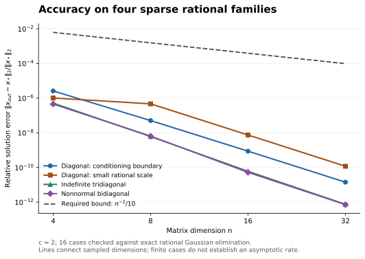
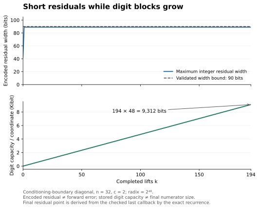
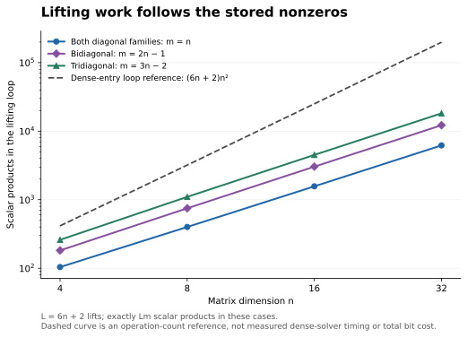

# Sparse rational lifting

A Python implementation of Jonathan A. Kelner's identity-modulus sparse
linear solver, specialized to short rational inputs. The core algorithm and
fast bounded rational reconstruction are due to Kelner; this package provides
rational rounding, a native binding, callable API and finite validation.
See [Kelner's primary preprint](https://arxiv.org/abs/2609.38101v1), Theorem 2.3
and Section 3, and the [pinned mathematical input contract](https://github.com/MColbrook/AIM/blob/c9929805cece044705abaaebe1cebddac1ba11a6/problems/044-sparse-linear-solve-bit-complexity.md).
No algorithmic priority or upstream acceptance is asserted.

The implementation, API, tests, benchmarks and documentation were produced by
AI agents under Kaiwen Jin's direction. This includes the API and parameter
policy maintenance in version 0.2.0. FLINT and python-flint are third-party
projects with their own attribution and licenses. AI development and finite
tests do not establish independent human review or formal proof certification.

## Install and make a default call

Python 3.11+ and the pinned `python-flint==0.8.0` wheel are required for the
fast backend. Its native binding supports LP64 64-bit macOS/Linux; this
release was exercised on macOS arm64, Python 3.13.3 and FLINT 3.3.1.
Linux was not executed in this validation; Windows/custom FLINT builds are
unsupported by the native binding.

From a checkout of this repository, install the package rather than relying
on `PYTHONPATH`:

```sh
python3 -m venv .venv
.venv/bin/python -m pip install .
.venv/bin/python -m aim044_lift numerical_case/example-auto.json
```

```python
from fractions import Fraction
from aim044_lift import solve

# The diagonal magnitudes justify condition number 3 for this specific matrix.
entries = [(0, 0, -1), (1, 1, Fraction(1, 3))]
result = solve(2, entries, [1, 1], condition_bound=3)
print(result.config.as_dict())  # selected c=2; conditional error bound 1/40
for value in result.x:
    print(hex(value.numerator), hex(value.denominator))
```

For n>1, supply a justified condition-number upper bound or the legacy c
promise. General conditioning is not inferred from entries. No universal
`c=2` default is assumed. A missing promise produces an actionable error.
For a validated nonzero 1-by-1 scalar, the exact condition number is 1 and
can be selected without an additional promise.

## Parameters and useful choices

The [complete API contract](docs/API.md) gives every type, range, default,
selection rule, error and accuracy/work/storage consequence. All values are
dimensionless after application-specific scaling.

| Input or setting | Default and recommendation |
| --- | --- |
| `n`, `entries`, `rhs` | Required square dimension, unique zero-based nonzero triples, and nonzero rational right-hand side. Prefer `int`/`Fraction`; finite floats retain their exact binary value. |
| `c` | `None`: automatically choose the smallest admissible positive exponent. Existing positional/keyword c calls keep their compound promise and output. |
| `condition_bound` | `None`: require justified information when automatic selection is not possible. A caller-supplied bound is not a matrix-condition certificate. With explicit c it must fit the c contract. |
| `relative_tolerance` | `None`: use n**(-c)/10 after selection. Supply an exact positive tolerance to request a stricter target; the selector raises c or reports incompatibility. For n=1 the supported guarantee is 1/10. |
| `reconstruction` | `None` resolves to fast `"flint"`. Explicit `"euclid"` is a slower exact reference with a different bit complexity. Unavailable FLINT causes an error before lifting; no fallback or accuracy relaxation. |
| `trace` | `None`. Optional callback for diagnostic integer residuals/digits; callback work and storage are outside production solver costs. |

The automatic exponent covers the observed rational-input bits, the supplied
condition bound and any requested accuracy, using exact integer/rational
comparisons. The same implementation serves API and CLI. Rounding scale,
byte-aligned radix and lifting count are selected internally and exposed by
the result; users do not tune them. A larger exponent can increase arithmetic
width, memory and runtime. The default policy is not claimed to be optimal.

```python
strict = solve(2, entries, [1, 1], condition_bound=3,
               relative_tolerance=Fraction(1, 1000))
reference_mode = solve(2, entries, [1, 1], condition_bound=3,
                       reconstruction="euclid")
legacy = solve(2, entries, [1, 1], 2)
assert result.x == reference_mode.x == legacy.x
```

`result.config` records the actual contract and selection reasons;
`result.as_dict()` supplies exact hexadecimal rational pairs and JSON-ready
configuration. `matrix_promises_verified` remains false. Nonsingularity and
conditioning are not certified by a successful solve. For the promised
short-rational input model and fixed c, the mathematical construction's bound
is deterministic `~O_c(nm)` bit operations with relative Euclidean solution
error at most n**(-c)/10. Exact reference solutions and callback diagnostics
are separate validation work.

## Results at a glance

The four fixed sparse families at `n=4,8,16,32`, `c=2` illustrate accuracy
and the lifting mechanism. Each solution was checked against independent
exact rational Gaussian elimination. The figures show finite cases; their
connecting lines do not establish an asymptotic convergence rate.



**Accuracy.** All 16 cases satisfy the required relative Euclidean error bound
`n⁻² / 10`, including the diagonal case with condition number exactly `n²`.
The plotted error uses the exact reference; acceptance uses an exact
squared-norm inequality rather than a floating-point tolerance.



**Short integers inside the lifting loop.** For the conditioning-boundary case
at `n=32`, all 194 lifts retain integer residuals within the 90-bit bound,
while the stored digit capacity reaches 9,312 bits per coordinate. This
residual is an encoded lifting state, not a forward-error estimate. Stored
digit capacity is not the size of the final rational numerator. Every callback
state and digit was checked against a separately computed exact recurrence;
the final residual point follows from that recurrence.



**Work follows sparsity.** In these cases the loop performs exactly `Lm`
scalar products, with `L=6n+2` lifts and `m` stored nonzeros. At `n=32`, the
diagonal, bidiagonal and tridiagonal counts are 6,208, 12,222 and 18,236.
The dashed `Ln²` curve is a hypothetical dense-entry loop count; it is not
a measured dense-solver comparison or the solver's total bit cost.

The [full figure gallery and reproduction commands](numerical_case/README.md#result-figures)
also include [recorded timing medians and ranges](numerical_case/figures/timing.svg)
from three warm repeats on the recorded machine. Plotting scripts and the
small validated source data are public.

## Tests, benchmarks and reproduction

Version 0.2.1 reuses native reconstruction bounds across a solve and releases
consumed digit buffers. The numerical contract and exact rational output are
unchanged. It also preserves the caller's process-global FLINT thread setting.
See the [profile-driven optimization and memory report](bench/README.md) for
matched before/after samples, independent checks and reproduction commands.

```sh
OPENBLAS_NUM_THREADS=1 OMP_NUM_THREADS=1 .venv/bin/python -m unittest discover -s test -v
OPENBLAS_NUM_THREADS=1 OMP_NUM_THREADS=1 .venv/bin/python numerical_case/benchmark_policies.py --output numerical_case/raw/policies-reproduction
```

Use a fresh output directory. [All 30 tests](test/) passed in a fresh wheel
installation, including the minimal API/CLI path, overrides, automatic branches,
invalid/unavailable choices, exact Gaussian references, large reconstruction
and preserved legacy output. [Policy regression tests](test/test_api.py) cover
the new selection contract; [reference tests](test/test_solver.py) exercise
the mathematical arithmetic and representation.

The [matched policy report](numerical_case/published/POLICY_SUMMARY.md) compares
16 fixed inputs × three configurations: automatic defaults, explicit FLINT,
and explicit Euclid. All 48 policy/input combinations passed exact error and
residual-width checks and returned identical rational outputs at the same
accuracy requirement. Three rotated warm repeats include input normalization,
parameter selection and the entire solve. The recorded run took 2.31 seconds
in total, with about 38.3 MiB whole-process peak RSS, including independent
references and separate allocation checks. Per-policy Python allocation
figures exclude native allocations; this is not a claim of general speedup
or an optimal default.

The original [16-case report](numerical_case/published/SUMMARY.md), four vector
figures and 195-state trace have also been regenerated for these source bytes.
See [all case, figure and benchmark reproduction commands](numerical_case/README.md).
These are finite software checks, not an all-input theorem certificate or an
experimental proof of asymptotic complexity.

## Version and validation limits

[0.2.0 changes and compatibility notes](docs/CHANGELOG.md) describe the additive
API/configuration fields. The [0.2.0 inventory](releases/v0.2.0/PUBLIC_MANIFEST.json)
and [checksums](releases/v0.2.0/SHA256SUMS) bind the current public files. The root
`PUBLIC_MANIFEST.json` and `SHA256SUMS` are preserved historical 0.1.0 inventories
for [revision 6c372b6](https://github.com/yuiyuiui/sparse-rational-lifting/tree/6c372b68a56923f1b4c630adb874144377c890e4).
Earlier cited revisions remain available.

The default calls FLINT 3.3.1's
[bounded reconstruction](https://github.com/flintlib/flint/blob/v3.3.1/src/fmpq/reconstruct_fmpz_2.c)
and its [recursive half-GCD helpers](https://github.com/flintlib/flint/blob/v3.3.1/src/fmpq/get_cfrac_helpers.c).
The package does not change process-global FLINT thread settings. Set thread
limits explicitly when reproducing benchmarks. Very large inputs,
condition promises or accuracy requests can consume substantial resources;
no implicit truncation or reduced-precision mode is used. No third-party
source or binaries are vendored.
